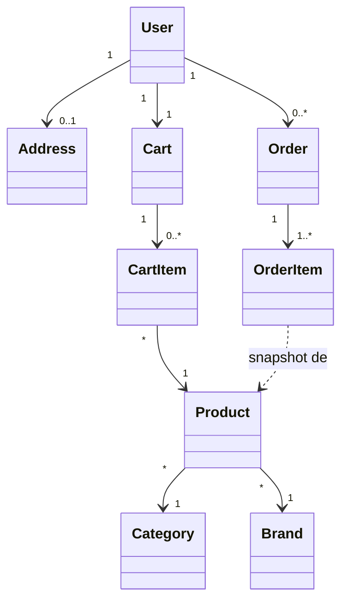
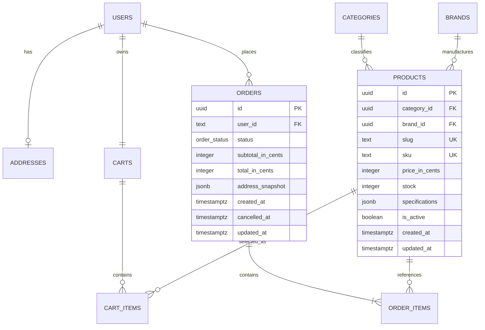
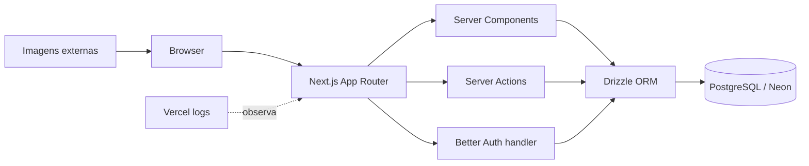

# DevStore

> Especificação funcional, visão arquitetural e contrato de produto da versão 1.0.

- **Versão:** 1.0
- **Status:** PLANEJAMENTO APROVADO
- **Tipo:** e-commerce B2C de peças de informática
- **Idioma:** português do Brasil
- **Moeda:** BRL

## 1. Visão do projeto

DevStore é uma loja virtual de catálogo próprio para consumidores comprarem peças de computador. O produto cobre descoberta de itens, autenticação, carrinho persistente, endereço, finalização sem pagamento e consulta de pedidos. A versão 1.0 é um projeto de portfólio com operação simplificada, mas mantém regras críticas no servidor e consistência transacional no PostgreSQL.

### Problema

Consumidores precisam consultar e selecionar peças de informática em uma experiência simples, responsiva e rastreável. A loja precisa manter catálogo e estoque próprios sem introduzir painel administrativo, integração de pagamento ou logística nesta versão.

### Objetivo

Entregar um MVP demonstrável de e-commerce que valide catálogo, autenticação, carrinho e pedido, com arquitetura suficiente para operação real em pequena escala e sem abstrações antecipadas.

## 2. Escopo

### Incluído na versão 1.0

- página inicial com produtos em destaque e atalhos por categoria;
- catálogo público com 10 produtos inseridos por seed;
- página pública de detalhe de produto;
- busca parcial e sem diferenciação entre maiúsculas e minúsculas;
- busca por nome, descrição, marca e categoria;
- filtros combináveis por categoria, marca, faixa de preço e disponibilidade;
- estado de busca e filtros refletido na URL por `searchParams`;
- cadastro, login, sessão e logout com e-mail e senha;
- carrinho persistente no PostgreSQL, disponível somente a usuário autenticado;
- endereço brasileiro único por usuário, preenchido manualmente;
- revisão e confirmação do pedido;
- finalização sem pagamento, com baixa de estoque;
- histórico e detalhe dos pedidos do usuário;
- cancelamento confirmado até 5 minutos após criação, com reposição de estoque;
- edição somente do nome do perfil;
- interface tecnológica clara, responsiva e acessível;
- SEO básico para páginas públicas.

### Fronteiras

- a loja possui o estoque e vende diretamente ao consumidor;
- somente peças de computador pertencem ao catálogo;
- catálogo, marcas, categorias e estoque são mantidos por seed/migração;
- não existe ator administrador na aplicação;
- catálogo e detalhes são públicos;
- qualquer mutação de carrinho, endereço, perfil ou pedido exige sessão válida;
- PostgreSQL é fonte de verdade desde a primeira versão.

## 3. Fora de escopo

- painel administrativo;
- marketplace ou vendedores terceiros;
- pagamento real ou simulado;
- cálculo de frete, prazo ou rastreamento;
- integração ViaCEP;
- avaliações, favoritos e cupons;
- recuperação de senha;
- confirmação de e-mail;
- exclusão de conta;
- edição de senha;
- edição ou exclusão do endereço após cadastro;
- múltiplos endereços;
- ordenação ou paginação obrigatória do catálogo;
- rate limiting específico da aplicação;
- Sentry, trilha de auditoria avançada ou observabilidade dedicada;
- textos legais, consentimento, termos e política de privacidade;
- alta disponibilidade ou escala empresarial;
- camada repository preparada para trocar a fonte de dados;
- API pública REST/GraphQL;
- aplicativo móvel nativo.

## 4. Stakeholders e atores

| Ator | Papel e objetivo | Responsabilidades | Permissões principais |
|---|---|---|---|
| Visitante | Descobrir produtos | Navegar, pesquisar e filtrar | Ler catálogo, categorias, marcas e detalhes |
| Cliente autenticado | Comprar e acompanhar peças | Manter perfil, endereço e carrinho; confirmar ou cancelar pedido | Operar somente dados ligados ao próprio `userId` |
| Loja | Proprietária do catálogo e estoque | Manter dados por seed/migração fora da UI | Sem acesso administrativo na aplicação |
| Operação técnica | Manter aplicação e banco | Executar migrations, seed, logs e recuperação | Acesso operacional externo, não modelado como ator funcional |

## 5. Requisitos funcionais

### RF-001 — Consultar página inicial

- **Prioridade:** MUST
- **Atores:** Visitante, Cliente autenticado
- **Descrição:** exibir identidade da DevStore, produtos em destaque e atalhos por categoria.
- **Resultado:** usuário alcança catálogo ou produto com navegação clara.
- **Critérios de aceitação:** conteúdo responsivo; links funcionais; produtos indisponíveis identificados.
- **Relacionamentos:** UC-001, RN-001, RN-003.

### RF-002 — Consultar catálogo

- **Prioridade:** MUST
- **Atores:** Visitante, Cliente autenticado
- **Descrição:** listar os 10 produtos ativos com imagem, nome, marca, categoria, preço e disponibilidade.
- **Resultado:** catálogo reflete dados atuais do PostgreSQL.
- **Critérios de aceitação:** preço em BRL; indisponível quando estoque for zero; fallback para falha de imagem.
- **Relacionamentos:** UC-001, RN-001, RN-002, RN-003.

### RF-003 — Buscar e filtrar produtos

- **Prioridade:** MUST
- **Atores:** Visitante, Cliente autenticado
- **Descrição:** buscar por texto e combinar filtros de categoria, marca, faixa de preço e disponibilidade.
- **Resultado:** URL representa estado consultado.
- **Critérios de aceitação:** busca parcial e case-insensitive; filtros combináveis; parâmetros inválidos recebem padrão seguro; URL pode ser compartilhada.
- **Relacionamentos:** UC-002, RN-004.

### RF-004 — Consultar produto

- **Prioridade:** MUST
- **Atores:** Visitante, Cliente autenticado
- **Descrição:** mostrar página por slug com descrição, especificações, imagem, preço, SKU e disponibilidade.
- **Resultado:** usuário entende produto antes de adicioná-lo ao carrinho.
- **Critérios de aceitação:** slug inexistente produz 404; CTA de carrinho respeita autenticação e estoque.
- **Relacionamentos:** UC-003, RN-002, RN-003.

### RF-005 — Criar conta e autenticar

- **Prioridade:** MUST
- **Atores:** Visitante
- **Descrição:** cadastrar nome, e-mail único e senha; permitir login e logout.
- **Resultado:** sessão segura gerenciada pelo Better Auth.
- **Critérios de aceitação:** e-mail normalizado e único; senha segue limites do provedor; credenciais inválidas não criam sessão; sem confirmação de e-mail.
- **Relacionamentos:** UC-004, RN-005.

### RF-006 — Editar perfil

- **Prioridade:** SHOULD
- **Atores:** Cliente autenticado
- **Descrição:** permitir alteração somente do nome.
- **Resultado:** nome atualizado sem permitir edição de e-mail ou senha.
- **Critérios de aceitação:** sessão obrigatória; nome validado; usuário não altera outro perfil.
- **Relacionamentos:** UC-005, RN-006.

### RF-007 — Cadastrar endereço

- **Prioridade:** MUST
- **Atores:** Cliente autenticado
- **Descrição:** cadastrar um endereço brasileiro com CEP, rua, número, complemento opcional, bairro, cidade e UF.
- **Resultado:** endereço associado exclusivamente ao usuário.
- **Critérios de aceitação:** um endereço por usuário; preenchimento manual; campos obrigatórios validados; sem edição/exclusão no MVP.
- **Relacionamentos:** UC-006, RN-007.

### RF-008 — Manter carrinho

- **Prioridade:** MUST
- **Atores:** Cliente autenticado
- **Descrição:** adicionar, atualizar quantidade e remover produtos no carrinho persistente.
- **Resultado:** um carrinho ativo por usuário e um item por produto.
- **Critérios de aceitação:** quantidade entre 1 e estoque atual; produto indisponível não entra; total visual recalculado com preço atual.
- **Relacionamentos:** UC-007, RN-008, RN-009.

### RF-009 — Revisar pedido

- **Prioridade:** MUST
- **Atores:** Cliente autenticado
- **Descrição:** exibir itens, quantidades, preços atuais, endereço e total antes da confirmação.
- **Resultado:** usuário confirma conscientemente a operação.
- **Critérios de aceitação:** endereço obrigatório; carrinho não vazio; divergências de preço/estoque atualizam revisão antes de finalizar.
- **Relacionamentos:** UC-008, RN-007, RN-009, RN-010.

### RF-010 — Finalizar pedido

- **Prioridade:** MUST
- **Atores:** Cliente autenticado
- **Descrição:** criar pedido finalizado sem pagamento, baixar estoque e limpar carrinho atomicamente.
- **Resultado:** pedido consistente e estoque sem saldo negativo.
- **Critérios de aceitação:** servidor recarrega preço e estoque; operação transacional; falha integral se qualquer item estiver inválido; snapshots preservados.
- **Relacionamentos:** UC-009, RN-010, RN-011, RN-012, RN-013.

### RF-011 — Consultar pedidos

- **Prioridade:** MUST
- **Atores:** Cliente autenticado
- **Descrição:** listar pedidos próprios e abrir detalhes.
- **Resultado:** cliente consulta estado, data, itens, endereço e totais históricos.
- **Critérios de aceitação:** acesso por proprietário; dados históricos não dependem do produto atual.
- **Relacionamentos:** UC-010, RN-014.

### RF-012 — Cancelar pedido

- **Prioridade:** MUST
- **Atores:** Cliente autenticado
- **Descrição:** cancelar pedido próprio após confirmação visual e dentro de 5 minutos da criação.
- **Resultado:** estado muda para cancelado e estoque retorna atomicamente.
- **Critérios de aceitação:** tempo calculado no servidor; somente pedido finalizado; após limite, recusar; repetição não duplica estoque.
- **Relacionamentos:** UC-011, RN-015, RN-016.

### RF-013 — Exibir interface responsiva e acessível

- **Prioridade:** MUST
- **Atores:** todos
- **Descrição:** oferecer uso completo em celular e desktop com direção visual tecnológica clara.
- **Resultado:** fluxos críticos utilizáveis por teclado e tecnologias assistivas.
- **Critérios de aceitação:** sem overflow impeditivo; foco visível; semântica e rótulos; contraste compatível com WCAG 2.1 AA.
- **Relacionamentos:** UC-001 a UC-011, RNF-003, RNF-004.

### RF-014 — Fornecer SEO básico

- **Prioridade:** SHOULD
- **Atores:** Visitante, mecanismos de busca
- **Descrição:** fornecer metadata coerente para início, catálogo e produto.
- **Resultado:** páginas públicas possuem título, descrição e canonical adequados.
- **Critérios de aceitação:** páginas privadas não são indexadas; slugs geram metadata de produto; URLs filtradas evitam indexação duplicada quando aplicável.
- **Relacionamentos:** UC-001 a UC-003, RNF-007.

## 6. Requisitos não funcionais

| ID | Categoria | Requisito verificável |
|---|---|---|
| RNF-001 | Segurança | Toda mutação valida sessão, propriedade do recurso e entrada no servidor. Segredos nunca entram no bundle cliente ou repositório. |
| RNF-002 | Integridade | Checkout e cancelamento executam em transações PostgreSQL e nunca deixam estoque negativo ou reposição duplicada. |
| RNF-003 | Acessibilidade | Fluxos críticos atendem WCAG 2.1 AA nos critérios automatizáveis e inspeção manual definida nos testes. |
| RNF-004 | Responsividade | Interface funciona a partir de 320 px e nos tamanhos desktop usuais, sem perda funcional. |
| RNF-005 | Desempenho | Páginas públicas buscam somente campos necessários, imagens são otimizadas e consultas de catálogo/pedido usam índices previstos. |
| RNF-006 | Compatibilidade | Suporte às versões estáveis atuais de Chrome, Edge, Firefox e Safari no momento da implementação. |
| RNF-007 | SEO | Páginas públicas possuem metadata; páginas autenticadas não devem ser indexadas. |
| RNF-008 | Observabilidade | Erros de servidor recebem log estruturado sem senha, token, cookie ou dados sensíveis. Logs padrão da Vercel bastam no MVP. |
| RNF-009 | Testabilidade | Regras transacionais e validações possuem testes Vitest; fluxos críticos possuem testes Playwright. |
| RNF-010 | Manutenibilidade | TypeScript estrito, módulos por domínio funcional, Server Actions pequenas e acesso Drizzle explícito. |
| RNF-011 | Temporalidade | Instantes persistidos usam `timestamptz`; regras usam tempo do servidor; UI exibe `America/Sao_Paulo`. |
| RNF-012 | Recuperação | Backup e disponibilidade usam capacidades contratadas do Neon; não existe mecanismo adicional no MVP. |
| RNF-013 | Privacidade | Senhas ficam sob Better Auth; aplicação não registra credenciais, sessões ou endereço completo em logs. |

## 7. Regras de negócio

| ID | Regra | RF/UC relacionados | Impacto no domínio |
|---|---|---|---|
| RN-001 | Catálogo contém somente peças de informática ativas. | RF-001, RF-002 / UC-001 | Produto possui flag de atividade. |
| RN-002 | Preço é armazenado em centavos inteiros, sempre maior ou igual a zero. | RF-002, RF-004 / UC-001, UC-003 | Evita ponto flutuante. |
| RN-003 | Produto com estoque zero permanece visível como indisponível. | RF-001, RF-002, RF-004 / UC-001, UC-003 | `stock = 0` não desativa produto. |
| RN-004 | Busca é parcial, case-insensitive e combina todos os filtros presentes em `searchParams`. | RF-003 / UC-002 | Consulta validada antes do ORM. |
| RN-005 | E-mail de usuário é único; autenticação usa e-mail e senha sem verificação de e-mail. | RF-005 / UC-004 | Better Auth mantém identidade e sessão. |
| RN-006 | Usuário pode editar somente o próprio nome. | RF-006 / UC-005 | E-mail e senha sem edição no MVP. |
| RN-007 | Usuário possui no máximo um endereço; pedido exige endereço. | RF-007, RF-009 / UC-006, UC-008 | Restrição única por usuário. |
| RN-008 | Usuário possui no máximo um carrinho ativo e um item de cada produto. | RF-008 / UC-007 | Restrições únicas em carrinho e item. |
| RN-009 | Quantidade deve ser inteira, mínima 1 e máxima igual ao estoque disponível. | RF-008, RF-009 / UC-007, UC-008 | Validação visual não substitui servidor. |
| RN-010 | Servidor é fonte de verdade para preço, estoque, usuário, endereço e total. | RF-009, RF-010 / UC-008, UC-009 | Cliente nunca envia total confiável. |
| RN-011 | Finalização cria pedido, itens e snapshots; reduz estoque; limpa carrinho em uma transação. | RF-010 / UC-009 | Atomicidade obrigatória. |
| RN-012 | Qualquer item inválido ou sem estoque aborta todo checkout. | RF-010 / UC-009 | Nenhum pedido parcial. |
| RN-013 | Pedido nasce `FINALIZED`; não existe etapa de pagamento. | RF-010 / UC-009 | Estado inicial único. |
| RN-014 | Cliente acessa somente pedidos ligados ao próprio usuário. | RF-011 / UC-010 | Autorização por propriedade. |
| RN-015 | Pedido `FINALIZED` pode ser cancelado até 5 minutos após `createdAt`, pelo tempo do servidor. | RF-012 / UC-011 | Janela temporal exata e testável. |
| RN-016 | Cancelamento muda estado uma vez e repõe estoque na mesma transação. | RF-012 / UC-011 | Idempotência contra reposição dupla. |
| RN-017 | Alterar produto, marca ou categoria exige migration/seed; não existe UI administrativa. | RF-001 a RF-004 / UC-001 a UC-003 | Operação fora da aplicação. |
| RN-018 | Pedido preserva snapshots de produto, preço e endereço. | RF-010, RF-011 / UC-009, UC-010 | Histórico não muda com catálogo/perfil. |

## 8. Casos de uso

### UC-001 — Navegar pela loja

- **Ator principal:** Visitante
- **Gatilho:** acesso à página inicial ou catálogo.
- **Fluxo principal:** carregar destaques/categorias; abrir catálogo; visualizar preço e disponibilidade.
- **Alternativas:** imagem externa falha e fallback aparece; produto sem estoque continua listado.
- **Pós-condição:** nenhuma alteração persistente.
- **Relacionamentos:** RF-001, RF-002; RN-001 a RN-003.

### UC-002 — Buscar e filtrar catálogo

- **Ator principal:** Visitante
- **Pré-condição:** catálogo disponível.
- **Fluxo principal:** informar busca; escolher filtros; URL é atualizada; servidor consulta combinações válidas.
- **Exceções:** parâmetro inválido é ignorado ou normalizado sem quebrar página.
- **Pós-condição:** URL compartilhável representa resultado.
- **Relacionamentos:** RF-003; RN-004.

### UC-003 — Consultar detalhe do produto

- **Ator principal:** Visitante
- **Fluxo principal:** abrir slug; ler descrição/especificações; consultar estoque; adicionar se autenticado.
- **Alternativas:** visitante é direcionado ao login ao tentar adicionar.
- **Exceções:** slug inexistente retorna 404.
- **Relacionamentos:** RF-004; RN-002, RN-003.

### UC-004 — Cadastrar e autenticar

- **Ator principal:** Visitante
- **Fluxo principal:** cadastrar nome, e-mail e senha; iniciar sessão; permitir logout.
- **Alternativas:** usuário existente faz login.
- **Exceções:** e-mail duplicado ou credencial inválida produz mensagem segura.
- **Pós-condição:** sessão Better Auth válida.
- **Relacionamentos:** RF-005; RN-005.

### UC-005 — Editar nome

- **Ator principal:** Cliente autenticado
- **Fluxo principal:** abrir perfil; alterar nome; confirmar.
- **Exceções:** nome inválido não persiste.
- **Relacionamentos:** RF-006; RN-006.

### UC-006 — Cadastrar endereço

- **Ator principal:** Cliente autenticado
- **Fluxo principal:** preencher endereço manual; validar; salvar.
- **Exceções:** segundo endereço ou campos inválidos são recusados.
- **Pós-condição:** endereço único associado ao cliente.
- **Relacionamentos:** RF-007; RN-007.

### UC-007 — Manter carrinho

- **Ator principal:** Cliente autenticado
- **Fluxo principal:** adicionar produto; alterar quantidade; remover item; consultar total atual.
- **Exceções:** sem estoque, quantidade inválida ou produto inativo são recusados.
- **Pós-condição:** carrinho persiste no banco.
- **Relacionamentos:** RF-008; RN-008, RN-009.

### UC-008 — Revisar compra

- **Ator principal:** Cliente autenticado
- **Pré-condições:** carrinho não vazio e endereço existente.
- **Fluxo principal:** servidor carrega dados atuais; exibe itens, endereço e total; cliente confirma.
- **Alternativas:** mudança de preço ou estoque atualiza revisão.
- **Relacionamentos:** RF-009; RN-007, RN-009, RN-010.

### UC-009 — Finalizar pedido

- **Ator principal:** Cliente autenticado
- **Pré-condições:** sessão, endereço e carrinho válidos.
- **Fluxo principal:** validar propriedade e catálogo; verificar estoque; criar pedido e itens; baixar estoque; limpar carrinho; confirmar.
- **Exceções:** qualquer inconsistência causa rollback total e resposta acionável.
- **Pós-condição:** pedido `FINALIZED` com snapshots.
- **Relacionamentos:** RF-010; RN-010 a RN-013, RN-018.

### UC-010 — Consultar pedidos

- **Ator principal:** Cliente autenticado
- **Fluxo principal:** listar pedidos próprios; abrir um pedido; visualizar snapshots, total e estado.
- **Exceções:** pedido de outro usuário aparece como não encontrado/não autorizado sem vazamento.
- **Relacionamentos:** RF-011; RN-014, RN-018.

### UC-011 — Cancelar pedido

- **Ator principal:** Cliente autenticado
- **Pré-condições:** pedido próprio em `FINALIZED` e dentro da janela.
- **Fluxo principal:** solicitar; confirmar visualmente; servidor valida tempo e estado; marca `CANCELLED`; repõe estoque.
- **Exceções:** prazo expirado, pedido já cancelado ou concorrência recusam a operação sem alterar estoque.
- **Relacionamentos:** RF-012; RN-015, RN-016.

## 9. Modelo conceitual do domínio

### Entidades

- **User:** identidade criada pelo Better Auth; possui sessão, um endereço, um carrinho e pedidos.
- **Address:** endereço brasileiro único do usuário.
- **Category:** classificação reutilizável de produtos.
- **Brand:** fabricante reutilizável.
- **Product:** peça vendável com SKU, slug, preço, estoque, imagem e especificações.
- **Cart:** carrinho persistente único do usuário.
- **CartItem:** produto e quantidade dentro do carrinho.
- **Order:** registro imutável da compra, exceto transição de estado para cancelado.
- **OrderItem:** snapshot comercial do item comprado.

### Objetos de valor

- **Money:** inteiro em centavos + moeda BRL implícita.
- **ProductSpecification:** conjunto estruturado em `jsonb`, validado no seed/leitura.
- **AddressSnapshot:** cópia do endereço no pedido.
- **OrderStatus:** `FINALIZED | CANCELLED`.

### Agregados e invariantes

- **Cart:** raiz `Cart`; não aceita item repetido ou quantidade fora do estoque.
- **Order:** raiz `Order`; total é soma dos snapshots; só permite `FINALIZED -> CANCELLED` dentro de 5 minutos.
- **Product inventory:** estoque nunca negativo; baixa e reposição ocorrem dentro da transação do pedido.

## 10. Modelo inicial de dados

Todos os instantes usam `timestamptz`. IDs podem usar UUID gerado no servidor/banco. Nomes finais das tabelas do Better Auth devem seguir o schema gerado pela versão fixada na implementação.

| Tabela | Campos principais | Restrições e índices |
|---|---|---|
| `users` | campos exigidos pelo Better Auth, `name`, `email`, timestamps | e-mail único; schema compatível com adapter Drizzle |
| `sessions` | campos Better Auth, `user_id`, expiração | índice por usuário/token conforme schema oficial |
| `accounts` | campos Better Auth, `user_id`, credencial | gerenciada pelo Better Auth |
| `verifications` | campos Better Auth | presente se exigido pelo schema, mesmo sem fluxo de confirmação |
| `addresses` | `id`, `user_id`, `postal_code`, `street`, `number`, `complement`, `neighborhood`, `city`, `state`, timestamps | `user_id` único; UF com 2 caracteres |
| `categories` | `id`, `name`, `slug`, timestamps | nome e slug únicos |
| `brands` | `id`, `name`, `slug`, timestamps | nome e slug únicos |
| `products` | `id`, `category_id`, `brand_id`, `name`, `slug`, `sku`, `description`, `price_in_cents`, `stock`, `image_url`, `specifications`, `is_active`, timestamps | slug/SKU únicos; preço/estoque >= 0; índices de catálogo |
| `carts` | `id`, `user_id`, timestamps | `user_id` único |
| `cart_items` | `id`, `cart_id`, `product_id`, `quantity`, timestamps | par carrinho/produto único; quantidade > 0 |
| `orders` | `id`, `user_id`, `status`, `subtotal_in_cents`, `total_in_cents`, snapshot do endereço, `created_at`, `cancelled_at`, `updated_at` | índice por usuário/data; total >= 0 |
| `order_items` | `id`, `order_id`, `product_id` anulável, `product_name`, `product_sku`, `unit_price_in_cents`, `quantity`, `line_total_in_cents` | snapshots obrigatórios; quantidade > 0 |

### Índices iniciais

- `products(slug)` e `products(sku)` únicos;
- `products(category_id, is_active)`;
- `products(brand_id, is_active)`;
- `products(price_in_cents)`;
- estratégia de busca textual começa simples com `ILIKE`; índice especializado somente após medição;
- `orders(user_id, created_at desc)`;
- `cart_items(cart_id, product_id)` único.

## 11. Arquitetura proposta

### Estilo

Monólito modular dentro de uma aplicação Next.js App Router. Server Components executam leituras server-side. Server Actions executam mutações e acessam Drizzle diretamente. Route Handler existe somente onde Better Auth exigir transporte HTTP.

Essa decisão reduz camadas no MVP. O custo aceito é acoplamento das ações ao ORM e maior trabalho caso a fonte de dados mude.

### Módulos

- `auth`: configuração Better Auth, sessão e guardas;
- `catalog`: categorias, marcas, produtos, busca e filtros;
- `profile`: nome e endereço;
- `cart`: carrinho e itens;
- `orders`: revisão, checkout, histórico e cancelamento;
- `db`: conexão, schema, migrations e seed;
- `ui`: componentes compartilhados e tokens visuais;
- `validation`: schemas de entrada compartilháveis quando necessário.

### Fluxo de execução

1. Página pública recebe `searchParams`, valida e consulta Drizzle no servidor.
2. Mutação chega a Server Action.
3. Action valida entrada e sessão.
4. Action deriva `userId` da sessão, nunca do cliente.
5. Action consulta/muta Drizzle.
6. Mutação transacional confirma ou reverte integralmente.
7. Action invalida/atualiza interface e retorna resultado tipado.

### Checkout concorrente

O checkout não confia no carrinho renderizado. Dentro da transação, recarrega itens e produtos, aplica baixa condicional somente quando `stock >= quantity`, verifica todas as linhas afetadas, cria snapshots e limpa o carrinho. Qualquer falha causa rollback.

### Cancelamento concorrente

Dentro da transação, a atualização do pedido exige proprietário correto, estado `FINALIZED` e janela ainda válida. Somente a transição bem-sucedida autoriza incrementar estoque. Repetição ou concorrência não repõe duas vezes.

Detalhes: [visão arquitetural](docs/architecture/overview.md) e [diagramas](docs/diagrams/key-flows.md).

## 12. Operações e interfaces

Não existe API pública própria no MVP. Leituras usam Server Components; mutações usam Server Actions. Server Actions são superfícies de rede e devem repetir autenticação, autorização e validação.

| Operação | Transporte | Autorização | Entrada principal | Saída | RF/RN/UC |
|---|---|---|---|---|---|
| listar catálogo | RSC `GET /produtos` | pública | `searchParams` validados | produtos/filtros | RF-002, RF-003 / RN-004 / UC-001, UC-002 |
| obter produto | RSC `GET /produtos/[slug]` | pública | slug | produto ou 404 | RF-004 / RN-002, RN-003 / UC-003 |
| autenticar | `GET/POST /api/auth/[...all]` | Better Auth | contrato Better Auth | sessão/erro | RF-005 / RN-005 / UC-004 |
| editar nome | Server Action | próprio usuário | nome | sucesso/erros de campo | RF-006 / RN-006 / UC-005 |
| cadastrar endereço | Server Action | próprio usuário | endereço | endereço/erro | RF-007 / RN-007 / UC-006 |
| adicionar item | Server Action | próprio usuário | productId, quantidade | carrinho/erro | RF-008 / RN-008, RN-009 / UC-007 |
| alterar/remover item | Server Action | dono do carrinho | itemId, quantidade/intenção | carrinho/erro | RF-008 / RN-008, RN-009 / UC-007 |
| revisar pedido | RSC `GET /checkout` | próprio usuário | sessão | revisão ou bloqueio | RF-009 / RN-007, RN-010 / UC-008 |
| finalizar pedido | Server Action | próprio usuário | confirmação/intenção idempotente quando definida na TASK | orderId/erro | RF-010 / RN-010 a RN-013 / UC-009 |
| listar/detalhar pedidos | RSC | próprio usuário | sessão/orderId | pedidos próprios | RF-011 / RN-014 / UC-010 |
| cancelar pedido | Server Action | dono do pedido | orderId + confirmação | estado/erro | RF-012 / RN-015, RN-016 / UC-011 |

## 13. Tecnologias sugeridas

| Tecnologia | Finalidade | Decisão e vantagem | Limitação aceita |
|---|---|---|---|
| Next.js App Router | UI e backend web | Server Components, Server Actions, metadata e deploy integrado | acoplamento ao runtime/framework |
| React + TypeScript estrito | interface e tipos | ecossistema e segurança de refatoração | tipos não substituem validação runtime |
| Tailwind CSS | estilos | composição rápida e consistente | exige disciplina de tokens/componentes |
| shadcn/ui | base acessível de componentes | código controlado pelo projeto | componentes precisam adaptação visual |
| Better Auth | autenticação | e-mail/senha, sessão e adapter Drizzle | schema e integração seguem contrato da biblioteca |
| Drizzle ORM + Drizzle Kit | acesso e migrations | SQL explícito, tipagem e transações | actions ficam acopladas ao ORM por decisão consciente |
| PostgreSQL no Neon | persistência | constraints, transações e branches isoladas | dependência de serviço gerenciado |
| Vitest | testes de regra e integração | feedback rápido e bom suporte TypeScript | banco de integração exige isolamento |
| Playwright | testes E2E | valida fluxos reais e acessibilidade automatizável | mais lento que testes unitários |
| Vercel | hospedagem futura | integração com Next.js e logs básicos | limites do plano e funções serverless |

Versões não são fixadas neste documento. A TASK de bootstrap deve registrar versões estáveis e compatíveis em lockfile e ADR somente se surgir decisão incompatível.

## 14. Estratégia de segurança

- habilitar e-mail/senha no Better Auth sem exigir verificação;
- usar schema oficial compatível com Drizzle/PostgreSQL;
- derivar usuário exclusivamente da sessão server-side;
- tratar toda Server Action como endpoint público alcançável por POST;
- validar entrada em runtime antes de acessar Drizzle;
- aplicar autorização por propriedade em carrinho, perfil, endereço e pedido;
- nunca aceitar preço, total, estoque, estado ou `userId` como verdade do cliente;
- usar transação e condições SQL para concorrência de estoque/cancelamento;
- cookies e sessão seguem configuração segura do Better Auth;
- manter URLs e segredos em variáveis de ambiente;
- não logar senha, cookie, token ou endereço completo;
- configurar `remotePatterns` restritos para imagens externas;
- manter páginas privadas fora de indexação;
- não adicionar rate limiting no MVP, risco aceito e documentado.

## 15. Estratégia de testes

### Vitest

- validação de `searchParams`, endereço e quantidades;
- cálculo em centavos e snapshots;
- regra de janela de 5 minutos;
- autorização por propriedade;
- integração com banco separado para constraints;
- checkout com estoque suficiente, insuficiente e concorrente;
- rollback quando um item falha;
- cancelamento válido, expirado, repetido e concorrente;
- isolamento entre usuários.

### Playwright

- visitante navega, pesquisa, filtra e abre produto;
- visitante é solicitado a autenticar ao adicionar;
- cadastro, login e logout;
- cliente cadastra endereço;
- cliente adiciona/edita/remove item;
- cliente revisa e finaliza pedido;
- carrinho é limpo e pedido aparece no histórico;
- cancelamento dentro da janela atualiza estado;
- acesso a recurso de outro usuário é bloqueado;
- navegação por teclado e verificações acessíveis aplicáveis;
- viewport móvel e desktop.

### Gates

Build, lint, typecheck, testes Vitest, testes de integração, Playwright, critérios de aceitação, segurança e regressão. Nenhum gate pode ser declarado aprovado sem execução registrada.

## 16. Riscos

| Risco | Categoria | Probabilidade | Impacto | Mitigação |
|---|---|---:|---:|---|
| corrida permite estoque negativo | técnico | média | alto | baixa condicional + transação + teste concorrente |
| cancelamento duplica reposição | técnico | média | alto | transição condicional de estado + transação |
| Server Actions crescem e misturam responsabilidades | arquitetura | média | médio | manter actions curtas; extrair serviço apenas quando complexidade real surgir |
| troca futura de ORM exige refatoração | arquitetura | média | médio | risco aceito; sem repository no MVP |
| URLs externas de imagem falham | integração | média | baixo | domínio restrito + fallback |
| ausência de rate limiting expõe autenticação a abuso | segurança | baixa no portfólio | médio | risco aceito no MVP; revisar antes de uso público relevante |
| banco de teste contamina desenvolvimento | operacional | baixa | alto | branch Neon separada e URL exclusiva |
| mudanças de preço entre carrinho e checkout surpreendem | negócio | média | médio | revisão com preço atual e mensagem de alteração |
| escopo de portfólio vira produto comercial | escopo | média | alto | respeitar fora de escopo e abrir novas TASKs/ADRs |

## 17. Roadmap

| Fase | Objetivo | Entregáveis | Dependência | Critério de conclusão |
|---|---|---|---|---|
| PHASE-01 | Fundação segura | app, design base, banco, migrations, seed e auth | nenhuma | checkpoint TASK-005 aprovado |
| PHASE-02 | Descoberta de produtos | home, catálogo, busca/filtros, detalhes e SEO básico | PHASE-01 | checkpoint TASK-009 aprovado |
| PHASE-03 | Jornada de compra | perfil, endereço, carrinho, checkout, pedidos e cancelamento | PHASE-02 | checkpoint TASK-014 aprovado |
| PHASE-04 | Hardening e aceite | testes completos, acessibilidade, segurança e documentação operacional | PHASE-03 | checkpoint TASK-018 aprovado |

## 18. ADRs

- [ADR-001 — Monólito modular com Next.js App Router](docs/adr/ADR-001-nextjs-modular-monolith.md)
- [ADR-002 — Server Actions e acesso direto ao Drizzle](docs/adr/ADR-002-server-actions-direct-drizzle.md)
- [ADR-003 — PostgreSQL gerenciado pelo Neon](docs/adr/ADR-003-postgresql-neon.md)
- [ADR-004 — Better Auth com e-mail e senha](docs/adr/ADR-004-better-auth.md)
- [ADR-005 — Checkout e cancelamento transacionais](docs/adr/ADR-005-transactional-orders.md)

## 19. Matriz de rastreabilidade

| RF | RN | RNF | UC | Entidade | Operação | Teste | TASK |
|---|---|---|---|---|---|---|---|
| RF-001 | RN-001, RN-003 | RNF-003 a RNF-007 | UC-001 | Product, Category | home RSC | E2E navegação | TASK-006 |
| RF-002 | RN-001 a RN-003 | RNF-005, RNF-006 | UC-001 | Product, Brand, Category | catálogo RSC | integração catálogo + E2E | TASK-007 |
| RF-003 | RN-004 | RNF-005, RNF-007 | UC-002 | Product, Brand, Category | catálogo `searchParams` | unit parâmetros + E2E | TASK-007 |
| RF-004 | RN-002, RN-003 | RNF-005, RNF-007 | UC-003 | Product | detalhe RSC | integração + E2E | TASK-008 |
| RF-005 | RN-005 | RNF-001, RNF-013 | UC-004 | User, Session, Account | Better Auth handler | integração auth + E2E | TASK-004 |
| RF-006 | RN-006 | RNF-001 | UC-005 | User | editar nome action | unit/autorização + E2E | TASK-010 |
| RF-007 | RN-007 | RNF-001, RNF-013 | UC-006 | Address | cadastrar endereço action | integração constraint + E2E | TASK-010 |
| RF-008 | RN-008, RN-009 | RNF-001, RNF-002 | UC-007 | Cart, CartItem, Product | actions carrinho | integração + E2E | TASK-011 |
| RF-009 | RN-007, RN-009, RN-010 | RNF-001 | UC-008 | Cart, Address, Product | checkout RSC | integração + E2E | TASK-012 |
| RF-010 | RN-010 a RN-013, RN-018 | RNF-001, RNF-002, RNF-011 | UC-009 | Order, OrderItem, Product, Cart | finalizar action | transação/concorrência + E2E | TASK-012 |
| RF-011 | RN-014, RN-018 | RNF-001, RNF-011 | UC-010 | Order, OrderItem | pedidos RSC | autorização + E2E | TASK-013 |
| RF-012 | RN-015, RN-016 | RNF-001, RNF-002, RNF-011 | UC-011 | Order, OrderItem, Product | cancelar action | tempo/idempotência + E2E | TASK-013 |
| RF-013 | todas aplicáveis | RNF-003, RNF-004, RNF-006 | UC-001 a UC-011 | todas | todas as páginas | acessibilidade/viewports | TASK-006, TASK-016 |
| RF-014 | RN-001, RN-004 | RNF-007 | UC-001 a UC-003 | Product, Category | Metadata API | teste metadata/E2E | TASK-008, TASK-016 |

## 20. Pendências

| ID | Descrição | Impacto | Itens afetados | Condição de resolução |
|---|---|---|---|---|
| PD-001 | Definir os 10 produtos, marcas, categorias, especificações e URLs de imagem exatos. | baixo | seed, catálogo | resolver durante TASK-003 sem alterar regras |
| PD-002 | Fixar versões compatíveis das dependências. | médio | bootstrap, auth, testes | resolver na TASK-001 com documentação oficial e lockfile |
| PD-003 | Definir domínio externo permitido para imagens. | baixo | Next Image, seed | resolver na TASK-003 |
| PD-004 | Definir variáveis e limites do plano Neon/Vercel usados no ambiente real. | baixo no desenvolvimento | operação | resolver antes de publicação; deploy não autorizado pelo planejamento |

Nenhuma pendência atual bloqueia o início da TASK-001.

## 21. Referências técnicas oficiais

- [Next.js App Router](https://nextjs.org/docs/app)
- [Next.js: mutação de dados e Server Actions](https://nextjs.org/docs/app/getting-started/mutating-data)
- [Better Auth: e-mail e senha](https://better-auth.com/docs/authentication/email-password)
- [Better Auth: adapter Drizzle](https://better-auth.com/docs/adapters/drizzle)
- [Drizzle: transações](https://orm.drizzle.team/docs/transactions)
- [Neon: workflow com branches](https://neon.com/docs/get-started-with-neon/workflow-primer)

## 22. Responsabilidade documental

- `README.md`: o que construir e por quê.
- `AGENTS.md`: como o agente deve trabalhar.
- `TASKS.md`: o que executar, em qual ordem, estado e limite.
- `docs/adr/`: por que decisões arquiteturais foram tomadas.
- `docs/architecture/`: detalhes da arquitetura.
- `docs/diagrams/`: representações visuais.
- código e testes futuros: implementação autorizada pelas TASKs.
