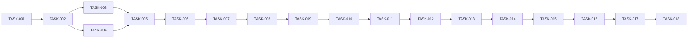

# DevStore — Backlog executável

## 1. Regras operacionais

- Estados: `BLOCKED | READY | IN_PROGRESS | IN_REVIEW | DONE | FAILED | CANCELLED`.
- Executar somente primeira TASK elegível em `READY`, salvo autorização explícita diferente.
- Uma TASK somente muda para `READY` quando toda Definition of Ready estiver satisfeita.
- Concluir uma TASK não autoriza iniciar a próxima.
- Estados mudam neste arquivo; `README.md` não recebe progresso operacional.
- Cada TASK obedece simultaneamente objetivo, requisitos, ADRs e Scope Guard.

## 2. Índice de execução

| Ordem | TASK | Fase | Prioridade | Dependências | Estado |
|---:|---|---|---|---|---|
| 1 | TASK-001 — Bootstrap da aplicação | PHASE-01 | CRITICAL | NONE | READY |
| 2 | TASK-002 — Schema e migrations | PHASE-01 | CRITICAL | TASK-001 | BLOCKED |
| 3 | TASK-003 — Seed do catálogo | PHASE-01 | HIGH | TASK-002 | BLOCKED |
| 4 | TASK-004 — Autenticação | PHASE-01 | CRITICAL | TASK-002 | BLOCKED |
| 5 | TASK-005 — Checkpoint PHASE-01 | PHASE-01 | CRITICAL | TASK-003, TASK-004 | BLOCKED |
| 6 | TASK-006 — Design system e página inicial | PHASE-02 | HIGH | TASK-005 | BLOCKED |
| 7 | TASK-007 — Catálogo, busca e filtros | PHASE-02 | HIGH | TASK-006 | BLOCKED |
| 8 | TASK-008 — Detalhe e SEO público | PHASE-02 | HIGH | TASK-007 | BLOCKED |
| 9 | TASK-009 — Checkpoint PHASE-02 | PHASE-02 | CRITICAL | TASK-008 | BLOCKED |
| 10 | TASK-010 — Perfil e endereço | PHASE-03 | HIGH | TASK-009 | BLOCKED |
| 11 | TASK-011 — Carrinho persistente | PHASE-03 | CRITICAL | TASK-010 | BLOCKED |
| 12 | TASK-012 — Revisão e checkout transacional | PHASE-03 | CRITICAL | TASK-011 | BLOCKED |
| 13 | TASK-013 — Histórico e cancelamento | PHASE-03 | CRITICAL | TASK-012 | BLOCKED |
| 14 | TASK-014 — Checkpoint PHASE-03 | PHASE-03 | CRITICAL | TASK-013 | BLOCKED |
| 15 | TASK-015 — Hardening de testes | PHASE-04 | HIGH | TASK-014 | BLOCKED |
| 16 | TASK-016 — E2E, acessibilidade e SEO | PHASE-04 | HIGH | TASK-015 | BLOCKED |
| 17 | TASK-017 — Segurança e operação | PHASE-04 | HIGH | TASK-016 | BLOCKED |
| 18 | TASK-018 — Checkpoint final | PHASE-04 | CRITICAL | TASK-017 | BLOCKED |

## 3. Grafo e ordem topológica



Validação: todas as referências existem; não há ciclos; checkpoints bloqueiam fase seguinte.

## 4. Definition of Ready global

Uma TASK pode ficar `READY` somente quando:

- requisitos e critérios de aceitação estão definidos;
- todas as dependências estão `DONE` e seus artefatos existem;
- ADRs necessários estão `ACCEPTED`;
- nenhuma pendência bloqueante permanece;
- testes esperados estão especificados;
- `Allowed Changes`, política incidental e `Forbidden Changes` estão definidos;
- execução cabe no Scope Guard;
- usuário autorizou iniciar a TASK e os comandos necessários.

## 5. Definition of Done global

- implementação e testes previstos concluídos;
- build, lint e typecheck passam;
- testes aplicáveis passam em ambiente apropriado;
- critérios de aceitação e requisitos relacionados são satisfeitos;
- segurança, erros e autorização foram verificados;
- documentação necessária foi atualizada;
- nenhuma regressão conhecida;
- alterações classificadas como `PRIMARY` ou `INCIDENTAL`;
- nenhum `Forbidden Changes` ou scope creep;
- commits rastreáveis por `[TASK-xxx]` quando Git estiver disponível;
- TASK atualizada para `DONE` somente com evidência dos gates.

---

## TASK-001 — Bootstrap da aplicação

### Status

`READY`

### Phase / Priority

`PHASE-01` / `CRITICAL`

### Objetivo

Criar base Next.js App Router com TypeScript estrito, `pnpm`, Tailwind, shadcn/ui, lint, Vitest e Playwright, sem implementar domínio.

### Dependências

`DEPENDS_ON: NONE`

### Requisitos relacionados

RNF-003 a RNF-010; ADR-001.

### Artefatos esperados

- aplicação inicial executável;
- scripts de build, lint, typecheck e testes;
- configuração de TypeScript, estilos, testes e variáveis de ambiente exemplificadas;
- estrutura mínima coerente com `docs/architecture/overview.md`;
- lockfile `pnpm`.

### Allowed Changes

```text
ALLOWED_CHANGES:
- package.json
- pnpm-lock.yaml
- next.config.*
- tsconfig.json
- eslint.config.*
- postcss.config.*
- components.json
- playwright.config.*
- vitest.config.*
- .gitignore
- .env.example
- src/app/**
- src/components/**
- src/lib/**
- tests/**
- TASKS.md
```

### Incidental Changes Policy

`MINIMAL_DIRECTLY_CAUSED_CHANGES_ALLOWED`

### Forbidden Changes

```text
FORBIDDEN_CHANGES:
- implementar catálogo, autenticação, carrinho ou pedidos;
- criar schema/migrations de domínio;
- configurar ou executar deploy;
- usar credenciais reais em arquivos;
- alterar requisitos ou ADRs silenciosamente.
```

### Critérios de aceitação

- estrutura usa App Router e TypeScript estrito;
- página inicial técnica mínima carrega;
- scripts existem e não ocultam falhas;
- nenhum recurso funcional antecipado.

### Testes necessários

Executar instalação autorizada, lint, typecheck, build, teste Vitest mínimo e descoberta Playwright.

### Definition of Done

DoD global + ambiente reproduzível por `pnpm` + versões registradas no lockfile + PD-002 resolvida.

---

## TASK-002 — Schema e migrations

### Status

`BLOCKED`

### Phase / Priority

`PHASE-01` / `CRITICAL`

### Objetivo

Configurar Drizzle/PostgreSQL e criar schema, relations, constraints e migrations iniciais para autenticação e domínio.

### Dependências

`DEPENDS_ON: TASK-001`

### Requisitos relacionados

RF-002 a RF-012; RN-001 a RN-018; RNF-002, RNF-011; ADR-003, ADR-004, ADR-005.

### Artefatos esperados

Cliente server-only, configuração Drizzle Kit, schema Better Auth compatível, tabelas de domínio, migration inicial e estratégia de banco de teste.

### Allowed Changes

```text
ALLOWED_CHANGES:
- package.json
- pnpm-lock.yaml
- drizzle.config.*
- .env.example
- src/db/**
- src/features/auth/db/**
- tests/integration/db/**
- TASKS.md
```

### Incidental Changes Policy

`MINIMAL_DIRECTLY_CAUSED_CHANGES_ALLOWED`

### Forbidden Changes

```text
FORBIDDEN_CHANGES:
- aplicar migration em produção;
- inserir credenciais reais;
- implementar páginas ou Server Actions funcionais;
- alterar cardinalidades/regras aprovadas sem ADR;
- criar repository.
```

### Critérios de aceitação

- schema corresponde ao modelo do README;
- constraints cobrem unicidade e valores não negativos;
- instantes usam `timestamptz`;
- migrations aplicam em banco vazio e schema é verificável;
- banco de teste usa conexão distinta.

### Testes necessários

Typecheck; migration up em banco descartável; testes de constraints; inspeção do schema Better Auth.

### Definition of Done

DoD global + migration versionada + nenhuma execução em produção.

---

## TASK-003 — Seed do catálogo

### Status

`BLOCKED`

### Phase / Priority

`PHASE-01` / `HIGH`

### Objetivo

Definir e inserir 10 peças com categorias, marcas, imagens externas e especificações realistas.

### Dependências

`DEPENDS_ON: TASK-002`

### Requisitos relacionados

RF-001 a RF-004; RN-001 a RN-004, RN-017; PD-001, PD-003.

### Artefatos esperados

Seed idempotente ou deterministicamente repetível; 10 produtos distribuídos entre processadores, placas-mãe, memória, GPUs, armazenamento, fontes, gabinetes e refrigeração; domínio de imagem permitido e fallback definido.

### Allowed Changes

```text
ALLOWED_CHANGES:
- src/db/seed/**
- src/db/schema/** somente se ajuste não funcional diretamente necessário
- next.config.* para remotePatterns
- src/components/** somente fallback de imagem reutilizável
- tests/integration/seed/**
- README.md somente para resolver PD-001/PD-003 sem mudar escopo
- TASKS.md
```

### Incidental Changes Policy

`MINIMAL_DIRECTLY_CAUSED_CHANGES_ALLOWED`

### Forbidden Changes

```text
FORBIDDEN_CHANGES:
- painel administrativo;
- scraping ou importação remota;
- produto fora de peças de informática;
- alterar autenticação, carrinho ou pedidos;
- executar seed em produção sem autorização explícita.
```

### Critérios de aceitação

- exatamente 10 produtos ativos;
- slug e SKU únicos;
- preço em centavos e estoque não negativo;
- todas as relações válidas;
- imagens externas têm fallback.

### Testes necessários

Executar seed duas vezes no banco de teste conforme estratégia escolhida; validar contagens, constraints e relações.

### Definition of Done

DoD global + PD-001/PD-003 resolvidas + seed reproduzível.

---

## TASK-004 — Autenticação

### Status

`BLOCKED`

### Phase / Priority

`PHASE-01` / `CRITICAL`

### Objetivo

Integrar Better Auth com Drizzle e entregar cadastro, login, sessão, logout e proteção server-side.

### Dependências

`DEPENDS_ON: TASK-002`

### Requisitos relacionados

RF-005; RN-005; RNF-001, RNF-013; UC-004; ADR-004.

### Artefatos esperados

Configuração Better Auth, handler exigido, cliente autorizado, telas/formulários e utilitário server-side de sessão.

### Allowed Changes

```text
ALLOWED_CHANGES:
- src/features/auth/**
- src/app/(auth)/**
- src/app/api/auth/**
- src/lib/auth/**
- src/components/** somente componentes necessários aos formulários
- tests/unit/auth/**
- tests/integration/auth/**
- tests/e2e/auth/**
- .env.example
- package.json
- pnpm-lock.yaml
- TASKS.md
```

### Incidental Changes Policy

`MINIMAL_DIRECTLY_CAUSED_CHANGES_ALLOWED`

### Forbidden Changes

```text
FORBIDDEN_CHANGES:
- confirmação de e-mail;
- recuperação de senha;
- login social;
- rate limiting próprio;
- autenticação manual;
- armazenar ou registrar senha/token/cookie.
```

### Critérios de aceitação

- cadastro exige nome, e-mail único e senha válida;
- login/logout funcionam;
- sessão é lida no servidor;
- erro não revela material sensível;
- fluxo não exige confirmação de e-mail.

### Testes necessários

Validações unitárias; integração com banco; E2E cadastro/login/logout; sessão ausente e e-mail duplicado.

### Definition of Done

DoD global + schema/configuração coerentes com documentação oficial fixada.

---

## TASK-005 — Checkpoint PHASE-01

### Status

`BLOCKED`

### Phase / Priority

`PHASE-01` / `CRITICAL`

### Objetivo

Validar fundação antes de liberar catálogo.

### Dependências

`DEPENDS_ON: TASK-003, TASK-004`

### Requisitos relacionados

ADR-001 a ADR-005; RNF-001, RNF-002, RNF-009 a RNF-013.

### Artefatos esperados

Relatório de checkpoint com build, lint, typecheck, migrations, seed, auth, documentação e rastreabilidade.

### Allowed Changes

```text
ALLOWED_CHANGES:
- correções mínimas nos artefatos de TASK-001 a TASK-004
- docs/** somente correção de inconsistência comprovada
- README.md somente mudança estrutural real
- TASKS.md
```

### Incidental Changes Policy

`NO_INCIDENTAL_CHANGES`

### Forbidden Changes

```text
FORBIDDEN_CHANGES:
- implementar qualquer item da PHASE-02 ou posterior;
- ampliar escopo;
- mascarar gate falho;
- executar deploy/produção.
```

### Critérios de aceitação

Todos os gates aplicáveis passam; dependências existem; schema/seed/auth correspondem aos ADRs; nenhuma dívida bloqueante.

### Testes necessários

Suite completa existente, build, lint, typecheck, migration em banco limpo e smoke de auth.

### Definition of Done

DoD global + relatório de checkpoint + TASK-006 promovida a `READY` somente depois deste `DONE`.

---

## TASK-006 — Design system e página inicial

### Status

`BLOCKED`

### Phase / Priority

`PHASE-02` / `HIGH`

### Objetivo

Criar linguagem tecnológica clara, shell responsivo, navegação, estados compartilhados e página inicial com destaques/categorias.

### Dependências

`DEPENDS_ON: TASK-005`

### Requisitos relacionados

RF-001, RF-013; RN-001, RN-003; RNF-003, RNF-004, RNF-006; UC-001.

### Artefatos esperados

Tokens, tipografia, layout, header/footer, cards, fallback de imagem, estados vazio/erro/carregamento e home.

### Allowed Changes

```text
ALLOWED_CHANGES:
- src/app/(public)/**
- src/app/layout.*
- src/app/globals.css
- src/components/**
- src/features/catalog/components/**
- src/features/catalog/queries/** somente leitura da home
- tests/unit/ui/**
- tests/e2e/home/**
- TASKS.md
```

### Incidental Changes Policy

`MINIMAL_DIRECTLY_CAUSED_CHANGES_ALLOWED`

### Forbidden Changes

```text
FORBIDDEN_CHANGES:
- busca/filtros completos;
- carrinho, checkout ou pedidos;
- painel administrativo;
- mudar stack visual aprovada;
- estética escura como padrão principal.
```

### Critérios de aceitação

Home apresenta destaques/categorias; navegação funciona; 320 px e desktop funcionam; foco/contraste/semântica básicos atendidos.

### Testes necessários

Componentes críticos, navegação E2E, teclado básico e viewports móvel/desktop.

### Definition of Done

DoD global + revisão visual e acessível registrada.

---

## TASK-007 — Catálogo, busca e filtros

### Status

`BLOCKED`

### Phase / Priority

`PHASE-02` / `HIGH`

### Objetivo

Entregar catálogo server-side com busca e filtros combináveis refletidos em `searchParams`.

### Dependências

`DEPENDS_ON: TASK-006`

### Requisitos relacionados

RF-002, RF-003; RN-001 a RN-004; RNF-005; UC-001, UC-002.

### Artefatos esperados

Página de catálogo, schema de parâmetros, consulta Drizzle, controles acessíveis e estados vazio/erro.

### Allowed Changes

```text
ALLOWED_CHANGES:
- src/app/(public)/produtos/**
- src/features/catalog/**
- src/components/** somente componentes compartilhados diretamente necessários
- tests/unit/catalog/**
- tests/integration/catalog/**
- tests/e2e/catalog/**
- TASKS.md
```

### Incidental Changes Policy

`MINIMAL_DIRECTLY_CAUSED_CHANGES_ALLOWED`

### Forbidden Changes

```text
FORBIDDEN_CHANGES:
- paginação ou ordenação não exigida;
- motor externo de busca;
- mutação de produto;
- carrinho/checkout;
- índice de busca especializado sem evidência.
```

### Critérios de aceitação

Busca parcial/case-insensitive; filtros combináveis; URL compartilhável; parâmetros inválidos seguros; indisponíveis visíveis.

### Testes necessários

Unitários de parsing; integração de combinações; E2E busca, filtros, limpar filtros e URL compartilhada.

### Definition of Done

DoD global + consulta sem N+1 e seleção mínima de colunas revisada.

---

## TASK-008 — Detalhe e SEO público

### Status

`BLOCKED`

### Phase / Priority

`PHASE-02` / `HIGH`

### Objetivo

Criar detalhe por slug, metadata pública e regras de indexação do catálogo.

### Dependências

`DEPENDS_ON: TASK-007`

### Requisitos relacionados

RF-004, RF-014; RN-002, RN-003; RNF-007; UC-003.

### Artefatos esperados

Página de detalhe, 404, especificações, CTA contextual, metadata, canonical e bloqueio de indexação das áreas privadas.

### Allowed Changes

```text
ALLOWED_CHANGES:
- src/app/(public)/produtos/[slug]/**
- src/app/** metadata, robots e sitemap diretamente necessários
- src/features/catalog/**
- src/components/** somente detalhe/SEO
- tests/unit/catalog/**
- tests/integration/catalog/**
- tests/e2e/catalog/**
- TASKS.md
```

### Incidental Changes Policy

`MINIMAL_DIRECTLY_CAUSED_CHANGES_ALLOWED`

### Forbidden Changes

```text
FORBIDDEN_CHANGES:
- reviews, recomendação personalizada ou favoritos;
- schema markup inventado sem dados reais;
- carrinho completo;
- indexar páginas privadas.
```

### Critérios de aceitação

Produto válido mostra dados completos; slug inválido retorna 404; CTA respeita estoque/auth; metadata correta; filtros não criam duplicação indexável indevida.

### Testes necessários

Integração slug; metadata; 404; E2E produto disponível/indisponível e CTA visitante.

### Definition of Done

DoD global + SEO básico verificado.

---

## TASK-009 — Checkpoint PHASE-02

### Status

`BLOCKED`

### Phase / Priority

`PHASE-02` / `CRITICAL`

### Objetivo

Validar jornada pública, responsividade, acessibilidade e SEO antes da compra.

### Dependências

`DEPENDS_ON: TASK-008`

### Requisitos relacionados

RF-001 a RF-004, RF-013, RF-014; UC-001 a UC-003.

### Artefatos esperados

Relatório de checkpoint e correções restritas à PHASE-02.

### Allowed Changes

```text
ALLOWED_CHANGES:
- correções mínimas nos artefatos de TASK-006 a TASK-008
- tests/** relacionados à PHASE-02
- TASKS.md
```

### Incidental Changes Policy

`NO_INCIDENTAL_CHANGES`

### Forbidden Changes

```text
FORBIDDEN_CHANGES:
- implementar perfil, endereço, carrinho ou pedidos;
- mudar requisitos/arquitetura;
- ignorar falha acessível ou SEO conhecida.
```

### Critérios de aceitação

Fluxos públicos passam; mobile/desktop e teclado funcionam; metadata e 404 corretos; gates verdes.

### Testes necessários

Build, lint, typecheck, Vitest aplicável, integração catálogo e Playwright público.

### Definition of Done

DoD global + relatório + TASK-010 promovida somente após `DONE`.

---

## TASK-010 — Perfil e endereço

### Status

`BLOCKED`

### Phase / Priority

`PHASE-03` / `HIGH`

### Objetivo

Entregar área privada para editar nome e cadastrar manualmente um endereço único.

### Dependências

`DEPENDS_ON: TASK-009`

### Requisitos relacionados

RF-006, RF-007; RN-006, RN-007; RNF-001, RNF-013; UC-005, UC-006.

### Artefatos esperados

Página de perfil, action de nome, formulário/action de endereço e guardas de sessão/propriedade.

### Allowed Changes

```text
ALLOWED_CHANGES:
- src/app/(store)/perfil/**
- src/features/profile/**
- src/lib/** somente guarda/validação compartilhada necessária
- tests/unit/profile/**
- tests/integration/profile/**
- tests/e2e/profile/**
- TASKS.md
```

### Incidental Changes Policy

`MINIMAL_DIRECTLY_CAUSED_CHANGES_ALLOWED`

### Forbidden Changes

```text
FORBIDDEN_CHANGES:
- editar e-mail, senha ou endereço existente;
- múltiplos endereços;
- ViaCEP;
- excluir conta;
- acessar perfil alheio.
```

### Critérios de aceitação

Somente nome é editável; um endereço pode ser criado manualmente; segundo cadastro é recusado; usuário alheio nunca é afetado.

### Testes necessários

Validação; sessão ausente; propriedade; constraint de endereço único; E2E perfil/endereço.

### Definition of Done

DoD global + nenhum dado sensível nos logs.

---

## TASK-011 — Carrinho persistente

### Status

`BLOCKED`

### Phase / Priority

`PHASE-03` / `CRITICAL`

### Objetivo

Entregar carrinho PostgreSQL por usuário com inclusão, alteração e remoção seguras.

### Dependências

`DEPENDS_ON: TASK-010`

### Requisitos relacionados

RF-008; RN-008 a RN-010; RNF-001, RNF-002; UC-007.

### Artefatos esperados

Página/indicador de carrinho, queries e Server Actions, estados de erro/vazio e cálculo visual com preço atual.

### Allowed Changes

```text
ALLOWED_CHANGES:
- src/app/(store)/carrinho/**
- src/features/cart/**
- src/features/catalog/** somente CTA/integração direta
- src/components/** somente carrinho necessário
- tests/unit/cart/**
- tests/integration/cart/**
- tests/e2e/cart/**
- TASKS.md
```

### Incidental Changes Policy

`MINIMAL_DIRECTLY_CAUSED_CHANGES_ALLOWED`

### Forbidden Changes

```text
FORBIDDEN_CHANGES:
- carrinho anônimo/localStorage;
- aceitar userId/preço/total do cliente;
- permitir item duplicado ou quantidade acima do estoque;
- implementar checkout antecipadamente.
```

### Critérios de aceitação

Login obrigatório; um carrinho por usuário; um item por produto; quantidade válida; persistência entre sessões; isolamento de usuários.

### Testes necessários

Validação; constraints; produto inativo/sem estoque; add/update/remove; concorrência simples; isolamento; E2E.

### Definition of Done

DoD global + autorização server-side comprovada.

---

## TASK-012 — Revisão e checkout transacional

### Status

`BLOCKED`

### Phase / Priority

`PHASE-03` / `CRITICAL`

### Objetivo

Entregar revisão e finalização atômica sem pagamento, protegendo estoque, snapshots e carrinho.

### Dependências

`DEPENDS_ON: TASK-011`

### Requisitos relacionados

RF-009, RF-010; RN-007, RN-009 a RN-013, RN-018; RNF-001, RNF-002, RNF-011; UC-008, UC-009; ADR-005.

### Artefatos esperados

Página de revisão, bloqueios por pré-condição, Server Action transacional, pedido/itens com snapshots e resultado de sucesso/erro.

### Allowed Changes

```text
ALLOWED_CHANGES:
- src/app/(store)/checkout/**
- src/features/orders/checkout/**
- src/features/cart/** integração diretamente necessária
- src/db/** somente query/constraint mínima comprovadamente necessária
- tests/unit/orders/**
- tests/integration/orders/**
- tests/e2e/checkout/**
- TASKS.md
```

### Incidental Changes Policy

`MINIMAL_DIRECTLY_CAUSED_CHANGES_ALLOWED`

### Forbidden Changes

```text
FORBIDDEN_CHANGES:
- pagamento ou frete;
- confiar em total/preço/userId/estoque do cliente;
- pedido parcial;
- reserva temporária de estoque;
- fila/eventos;
- violar transação única.
```

### Critérios de aceitação

Endereço/carrinho obrigatórios; revisão usa dados atuais; pedido nasce `FINALIZED`; snapshots corretos; estoque nunca negativo; carrinho limpa somente no sucesso; falha reverte tudo.

### Testes necessários

Preço alterado; estoque insuficiente; múltiplos itens com falha intermediária; concorrência pelo último item; rollback; E2E feliz e bloqueios.

### Definition of Done

DoD global + evidência de atomicidade em PostgreSQL real de teste.

---

## TASK-013 — Histórico e cancelamento

### Status

`BLOCKED`

### Phase / Priority

`PHASE-03` / `CRITICAL`

### Objetivo

Entregar lista/detalhe de pedidos próprios e cancelamento transacional em até 5 minutos.

### Dependências

`DEPENDS_ON: TASK-012`

### Requisitos relacionados

RF-011, RF-012; RN-014 a RN-016, RN-018; RNF-001, RNF-002, RNF-011; UC-010, UC-011; ADR-005.

### Artefatos esperados

Páginas de histórico/detalhe, relógio informativo não autoritativo, confirmação visual e action de cancelamento.

### Allowed Changes

```text
ALLOWED_CHANGES:
- src/app/(store)/pedidos/**
- src/features/orders/**
- src/features/catalog/** somente exibição de snapshot/fallback necessário
- tests/unit/orders/**
- tests/integration/orders/**
- tests/e2e/orders/**
- TASKS.md
```

### Incidental Changes Policy

`MINIMAL_DIRECTLY_CAUSED_CHANGES_ALLOWED`

### Forbidden Changes

```text
FORBIDDEN_CHANGES:
- permitir acesso cruzado;
- usar relógio cliente como autoridade;
- cancelar após 5 minutos;
- repor estoque em repetição;
- editar ou excluir pedido.
```

### Critérios de aceitação

Histórico usa snapshots; somente dono acessa; confirmação obrigatória; limite usa servidor; estado muda uma vez; estoque reposto atomicamente.

### Testes necessários

Pedido próprio/alheio; antes/no limite/após 5 minutos; cancelamento repetido e concorrente; timezone de exibição; E2E.

### Definition of Done

DoD global + idempotência do efeito de estoque comprovada.

---

## TASK-014 — Checkpoint PHASE-03

### Status

`BLOCKED`

### Phase / Priority

`PHASE-03` / `CRITICAL`

### Objetivo

Validar jornada autenticada completa, segurança por propriedade e integridade transacional.

### Dependências

`DEPENDS_ON: TASK-013`

### Requisitos relacionados

RF-005 a RF-012; RN-005 a RN-016, RN-018; ADR-004, ADR-005.

### Artefatos esperados

Relatório de checkpoint e correções restritas à PHASE-03.

### Allowed Changes

```text
ALLOWED_CHANGES:
- correções mínimas nos artefatos de TASK-010 a TASK-013
- tests/** relacionados à PHASE-03
- TASKS.md
```

### Incidental Changes Policy

`NO_INCIDENTAL_CHANGES`

### Forbidden Changes

```text
FORBIDDEN_CHANGES:
- criar nova funcionalidade;
- afrouxar autorização/constraints/testes;
- alterar arquitetura para contornar falha;
- deploy/produção.
```

### Critérios de aceitação

Jornada completa passa; isolamento entre usuários; checkout/cancelamento concorrentes passam; nenhuma regressão pública.

### Testes necessários

Todos os gates existentes, banco limpo, jornada E2E completa e cenários de segurança/transação.

### Definition of Done

DoD global + relatório + TASK-015 promovida somente após `DONE`.

---

## TASK-015 — Hardening de testes

### Status

`BLOCKED`

### Phase / Priority

`PHASE-04` / `HIGH`

### Objetivo

Fechar lacunas de testes unitários e de integração sem alterar comportamento funcional.

### Dependências

`DEPENDS_ON: TASK-014`

### Requisitos relacionados

RNF-001, RNF-002, RNF-009, RNF-011; todos os RF/RN aplicáveis.

### Artefatos esperados

Matriz de cobertura comportamental, fixtures isoladas, testes de borda e execução determinística.

### Allowed Changes

```text
ALLOWED_CHANGES:
- tests/unit/**
- tests/integration/**
- código de produção somente correção mínima de defeito revelado por teste
- configuração Vitest
- TASKS.md
```

### Incidental Changes Policy

`MINIMAL_DIRECTLY_CAUSED_CHANGES_ALLOWED`

### Forbidden Changes

```text
FORBIDDEN_CHANGES:
- refatoração ampla;
- adicionar funcionalidade;
- testes que dependem de produção;
- mocks substituindo testes transacionais essenciais;
- reduzir assertions para obter verde.
```

### Critérios de aceitação

Todos os cenários críticos da estratégia do README têm cobertura adequada; testes são isolados e repetíveis.

### Testes necessários

Executar toda suite Vitest e integração múltiplas vezes contra banco descartável.

### Definition of Done

DoD global + nenhuma lacuna crítica sem justificativa registrada.

---

## TASK-016 — E2E, acessibilidade e SEO

### Status

`BLOCKED`

### Phase / Priority

`PHASE-04` / `HIGH`

### Objetivo

Consolidar Playwright para fluxos críticos, viewports, teclado, acessibilidade automatizável e SEO.

### Dependências

`DEPENDS_ON: TASK-015`

### Requisitos relacionados

RF-013, RF-014; RNF-003, RNF-004, RNF-006, RNF-007, RNF-009.

### Artefatos esperados

Suite E2E estável, relatório de acessibilidade manual/automatizada e verificações de metadata/indexação.

### Allowed Changes

```text
ALLOWED_CHANGES:
- tests/e2e/**
- playwright.config.*
- código UI/metadata somente correção mínima de defeito comprovado
- docs/architecture/** somente registro de verificação
- TASKS.md
```

### Incidental Changes Policy

`MINIMAL_DIRECTLY_CAUSED_CHANGES_ALLOWED`

### Forbidden Changes

```text
FORBIDDEN_CHANGES:
- redesign amplo;
- snapshot visual frágil como única validação;
- ignorar violações sem justificativa;
- testar serviços de produção.
```

### Critérios de aceitação

Fluxos críticos passam em mobile/desktop; teclado funciona; violações críticas/sérias resolvidas; metadata e noindex privados verificados.

### Testes necessários

Playwright completo; análise acessível automatizada quando ferramenta aprovada; checklist manual; inspeção metadata.

### Definition of Done

DoD global + evidência acessível e SEO registrada.

---

## TASK-017 — Segurança e operação

### Status

`BLOCKED`

### Phase / Priority

`PHASE-04` / `HIGH`

### Objetivo

Validar fronteiras de segurança, logs, segredos, banco de teste e documentação operacional sem fazer deploy.

### Dependências

`DEPENDS_ON: TASK-016`

### Requisitos relacionados

RNF-001, RNF-008, RNF-012, RNF-013; ADR-003, ADR-004.

### Artefatos esperados

Checklist de segurança, configuração segura revisada, runbook de migrations/seed/recuperação e variáveis documentadas.

### Allowed Changes

```text
ALLOWED_CHANGES:
- docs/architecture/**
- .env.example
- configurações de segurança/log diretamente relacionadas
- tests/** de autorização e segurança
- README.md somente mudança estrutural comprovada
- TASKS.md
```

### Incidental Changes Policy

`MINIMAL_DIRECTLY_CAUSED_CHANGES_ALLOWED`

### Forbidden Changes

```text
FORBIDDEN_CHANGES:
- deploy;
- acesso/migration/seed de produção;
- rate limiting, Sentry ou serviço novo;
- registrar segredo ou dado pessoal;
- afirmar backup/restauração testados sem evidência.
```

### Critérios de aceitação

Actions revalidam sessão/autorização; logs sanitizados; segredos ausentes do repo; ambiente de teste isolado; runbook coerente.

### Testes necessários

Testes negativos de autorização, inspeção de bundle/config/logs, `git diff` por segredo conhecido e gates completos aplicáveis.

### Definition of Done

DoD global + riscos aceitos permanecem explícitos + nenhum deploy.

---

## TASK-018 — Checkpoint final

### Status

`BLOCKED`

### Phase / Priority

`PHASE-04` / `CRITICAL`

### Objetivo

Validar versão 1.0 completa contra especificação, arquitetura, rastreabilidade, segurança e qualidade.

### Dependências

`DEPENDS_ON: TASK-017`

### Requisitos relacionados

Todos os RF, RN, RNF, UC e ADR.

### Artefatos esperados

Relatório final com gates, aceite por requisito, validação de escopo, riscos residuais e recomendação de publicação separada.

### Allowed Changes

```text
ALLOWED_CHANGES:
- correções mínimas de defeitos comprovados
- tests/**
- README.md somente correção de divergência real
- docs/**
- TASKS.md
```

### Incidental Changes Policy

`NO_INCIDENTAL_CHANGES`

### Forbidden Changes

```text
FORBIDDEN_CHANGES:
- nova funcionalidade ou redesign;
- deploy;
- alterar escopo para declarar sucesso;
- omitir falha, risco ou teste não executado;
- marcar DONE com gate obrigatório falho.
```

### Critérios de aceitação

Todos os requisitos MUST passam; SHOULD implementados estão validados; matriz rastreável; build/lint/typecheck/testes verdes; segurança e scope validados.

### Testes necessários

Todos os Quality Gates definidos no `AGENTS.md`, a partir de banco de teste controlado.

### Definition of Done

DoD global + relatório final aprovado. Publicação continua não autorizada.

## 6. Template de Scope Escalation

```text
## SCOPE ESCALATION

TASK: TASK-xxx
Necessidade identificada: ...
Motivo: ...
Arquivos/módulos afetados: ...
Allowed Changes atual: ...
Forbidden Changes relacionado: ...
Por que não é Incidental Change: ...
Impacto se não realizada: ...
Alternativas: ...
Recomendação: ...
Decisão necessária: ...
```

## 7. Template de relatório

```text
## TASK Execution Report

TASK: TASK-xxx
Status: DONE | FAILED | BLOCKED
Branch: ...
Commits: ...

### Primary Changes
...

### Incidental Changes
NONE | tabela com arquivo, alteração e justificativa

### Tests Executed
...

### Quality Gates
Build: PASS/FAIL/N/A
Lint: PASS/FAIL/N/A
Typecheck: PASS/FAIL/N/A
Unit Tests: PASS/FAIL/N/A
Integration Tests: PASS/FAIL/N/A
E2E Tests: PASS/FAIL/N/A
Security: PASS/FAIL/N/A
Acceptance Criteria: PASS/FAIL
Regression: PASS/FAIL/N/A

### Scope Validation
Allowed Changes: PASS/FAIL
Incidental Changes: PASS/FAIL/N/A
Forbidden Changes: PASS/FAIL
Scope Creep: NONE | descrição

### Definition of Done
PASS | FAIL

### Next Eligible TASK
TASK-xxx | NONE
```
